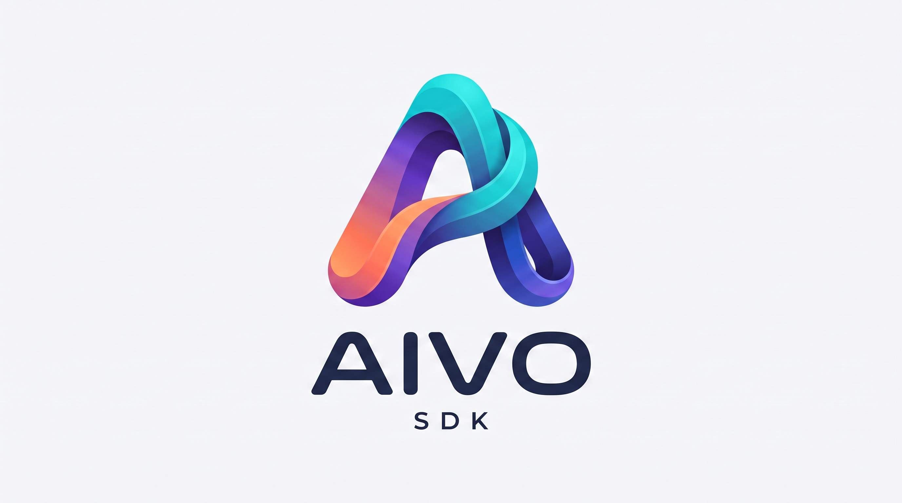

<div align="center">

<a href="https://abdallah-elsobky.github.io/Aivo-SDK/" target="_blank" rel="noopener noreferrer">
  
</a>

# 🤖 Aivo SDK

### Production-Grade · Provider-Agnostic · Kotlin Multiplatform Agentic AI Framework

Build and ship autonomous AI agents — with reactive streaming, type-safe tool calling, supervisor multi-agent teams, and production guardrails — across Android, iOS, and JVM from a single codebase.

<br/>

[](https://central.sonatype.com/artifact/io.github.abdallah-elsobky/aivo-sdk)
[](https://abdallah-elsobky.github.io/Aivo-SDK/)
[](https://github.com/Abdallah-Elsobky/Test-Aivo-SDK)
[](https://www.skills.sh/abdallah-elsobky/aivo-sdk)

<br/>

[](https://central.sonatype.com/artifact/io.github.abdallah-elsobky/aivo-sdk)
[](LICENSE)
[](https://kotlinlang.org/docs/multiplatform.html)
[](https://kotlinlang.org/docs/multiplatform.html)
[](https://developer.android.com/)

<br/>

[**🌐 Live Portal**](https://abdallah-elsobky.github.io/Aivo-SDK/) • [**📱 KMP Demo App**](#-production-kmp-demo-app) • [**🧠 Agent Skills**](#-agent-skills--ai-assisted-development) • [**📦 Installation**](#-installation) • [**⚡ Quick Start**](#-quick-start) • [**🔌 Providers**](#-providers) • [**📁 Samples**](#-samples)

</div>

---

### 🌟 Featured Highlights

| 🌐 [**Interactive Web Portal**](https://abdallah-elsobky.github.io/Aivo-SDK/) | 📱 [**Real-World KMP Demo App**](https://github.com/Abdallah-Elsobky/Test-Aivo-SDK) | 🧠 [**Agent Skills (skills.sh)**](https://www.skills.sh/abdallah-elsobky/aivo-sdk) |
| :--- | :--- | :--- |
| Live code configurator, IDE syntax highlighting, and architectural sequence diagrams. | Full Compose Multiplatform showcase with real-time streaming, chained tools, and MVI UI. | Official domain playbooks for Cursor, Claude Code, GitHub Copilot, and Antigravity. |

---

### ⚡ Quick Navigation

| 🚀 **Get Started** | 🧠 **Core Agent Engine** | 🛡️ **Production & Ecosystem** |
| :--- | :--- | :--- |
| • [**📦 Installation & Setup**](#-installation)<br/>• [**🔑 API Key Security**](#-storing-api-keys-securely)<br/>• [**⚡ Quick Start (3 Levels)**](#-quick-start)<br/>• [**🏗️ Architecture & Modules**](#-architecture) | • [**🔌 Providers & Models**](#-providers)<br/>• [**🤖 Defining Single Agents**](#-agents)<br/>• [**🛠️ Custom Tool Calling**](#%EF%B8%8F-tool-calling)<br/>• [**👥 Multi-Agent Teams**](#-multi-agent-teams) | • [**📱 KMP Demo App**](#-production-kmp-demo-app)<br/>• [**🧠 Official Agent Skills**](#-agent-skills--ai-assisted-development)<br/>• [**🌊 Flow Streaming**](#-streaming)<br/>• [**📁 Samples & Testing**](#-samples) |

<details>
<summary><strong>🔍 Full Detailed Topic Index (Click to expand)</strong></summary>

<br/>

- [Why Aivo SDK?](#-why-aivo-sdk)
- [Features at a Glance](#-features-at-a-glance)
- [Production KMP Demo App](#-production-kmp-demo-app)
- [Agent Skills & AI-Assisted Development](#-agent-skills--ai-assisted-development)
  - [What are Agent Skills?](#what-are-agent-skills)
  - [Available Skills (`aivo-android` & `aivo-kmp`)](#available-skills)
  - [How to Install & Use the Skills](#how-to-install--use-the-skills)
- [Architecture](#-architecture)
- [Installation](#-installation)
  - [Android (pure Android project)](#android-pure-android-project)
  - [Kotlin Multiplatform (KMP)](#kotlin-multiplatform-kmp)
- [Getting API Keys](#-getting-api-keys)
  - [Google Gemini](#google-gemini-free-tier-available)
  - [OpenRouter](#openrouter-free-models-available)
  - [Ollama (cloud — API key required)](#ollama-cloud--api-key-required)
- [Storing API Keys Securely](#-storing-api-keys-securely)
- [Quick Start](#-quick-start)
  - [Option A — One-Line Setup (Type-Safe Models)](#option-a--one-line-setup-fastest)
  - [Option B — Full Builder DSL](#option-b--full-builder-dsl-recommended-for-production)
  - [Option C — Raw LLM Client](#option-c--raw-llm-client-no-agent-loop)
  - [Typed Catalogs vs. Custom Models & Endpoints](#-typed-catalogs-vs-custom-models--endpoints)
- [Providers (Ollama, Gemini, OpenRouter, Custom Endpoints)](#-providers)
- [Agents (Kotlin DSL, Markdown Frontmatter, JSON)](#-agents)
- [Tool Calling & Human-in-the-Loop](#%EF%B8%8F-tool-calling)
- [Multi-Agent Teams & Supervisor Pattern](#-multi-agent-teams)
- [Streaming & Flow](#-streaming)
- [Memory & Context Management](#-memory--context)
- [Resilience & Production Guardrails](#-resilience--guardrails)
- [Observability & Telemetry](#-observability)
- [Error Handling](#-error-handling)
- [Offline Unit Testing](#-testing)
- [Samples](#-samples)
- [Contributing & License](#-contributing)

</details>

---

## 💡 Why Aivo SDK?

Most AI SDKs lock you into a single provider and a single platform. **Aivo SDK** is different:

| Pain Point | Aivo SDK Solution |
|---|---|
| Provider lock-in | One unified API for Gemini, Ollama, OpenRouter, and any OpenAI-compatible endpoint |
| Android & iOS fragmentation | True Kotlin Multiplatform — write once, deploy everywhere |
| Boilerplate agent loops | Prebuilt ReAct loop, supervisor delegation, and streaming out of the box |
| Unsafe API key handling | `SecretString` type with masked `toString()` — keys never leak into logs |
| Fragile production code | Built-in exponential backoff, rate-limit handling, tool timeouts, and human-in-the-loop gates |

---

## ✨ Features at a Glance

| Feature | Description |
|---|---|
| 🔌 **Provider Agnostic** | Gemini · Ollama · OpenRouter · Any OpenAI-compatible endpoint |
| 📝 **Declarative Agents** | Define agents in Kotlin DSL, Markdown (YAML frontmatter), or JSON |
| ⚡ **Full Streaming** | Token deltas, reasoning events, tool-call progress — all via `Flow` |
| 🤝 **Multi-Agent Teams** | Supervisor delegation with cycle detection, depth limits, and usage aggregation |
| 🛠️ **Custom Tool Calling** | Type-safe `tool { }` DSL with JSON Schema validation and risk classification |
| 🧠 **Memory & Context** | Keep-all, sliding-window, and token-budget context strategies |
| 🛡️ **Production Guardrails** | Exponential backoff, human-in-the-loop confirmation, automatic secrets redaction |
| 📱 **Cross-Platform** | Android (API 24+) · JVM 11+ · iOS (Apple Silicon & Simulator) |
| 🏗️ **Clean Architecture** | SOLID, ports-and-adapters — zero provider types leak into your domain models |
| 🧪 **Testing Support** | `FakeLlmProvider`, `InMemoryTelemetry`, pre-recorded fixture library |

---

## 📱 Production KMP Demo App

Looking for a complete, production-grade reference implementation? The **[Abdallah-Elsobky/Test-Aivo-SDK](https://github.com/Abdallah-Elsobky/Test-Aivo-SDK)** repository is a full-featured **Kotlin Multiplatform (KMP)** demo application built entirely with Aivo SDK and Compose Multiplatform across **Android**, **iOS**, and **Desktop**.

<div align="center">

<a href="https://github.com/Abdallah-Elsobky/Test-Aivo-SDK" target="_blank" rel="noopener noreferrer">
  
</a>

<br/>

<sub><em>Compose Multiplatform chat interface running Aivo SDK with real-time token streaming, tool execution, provider switching, and multi-agent coordination.</em></sub>

</div>

<br/>

### 🌟 What's Inside the Demo App?

- 🌐 **100% Kotlin Multiplatform**: Shared architecture (`commonMain`) compiling to Android (API 24+), iOS (ARM64 & Simulator), and Desktop (JVM).
- 🎨 **Compose Multiplatform UI**: Single declarative Material 3 chat screen with markdown rendering, message history, and typing animations.
- ⚡ **Reactive Token Streaming**: Smooth token-by-token deltas using Kotlin `Flow<AgentEvent>` directly collected into Compose `StateFlow`.
- 🛠️ **Dynamic Tool Calling**: Real-time tool invocation with parameters, validation, and execution results.
- 🛡️ **Human-in-the-Loop Confirmation Gates**: Interactive biometric/dialog approval requests when high-risk tools are triggered.
- 🔌 **Runtime Multi-Provider Switcher**: Switch dynamically between **Google Gemini**, **Ollama Cloud**, and **OpenRouter** with in-app API key configuration.
- 👥 **Multi-Agent Teams**: Supervisor agent orchestrating specialized sub-agents with cycle detection and step budgets.
- 🏗️ **Clean Architecture Blueprint**: MVVM / MVI pattern cleanly isolating presentation from SDK orchestration and domain logic.

### 🚀 Clone and Run the Demo

```bash
# Clone the official KMP demo repository
git clone https://github.com/Abdallah-Elsobky/Test-Aivo-SDK.git
cd Test-Aivo-SDK

# Open in Android Studio / Fleet / IntelliJ IDEA
# Add your API keys in local.properties or enter them directly inside the app UI:
# GEMINI_API_KEY=AIzaSy...
# OLLAMA_API_KEY=your_ollama_key

# Run Android app
./gradlew :composeApp:installDebug

# Run Desktop app
./gradlew :composeApp:run
```

👉 **[View the Test-Aivo-SDK Repository on GitHub →](https://github.com/Abdallah-Elsobky/Test-Aivo-SDK)**

---

## 🧠 Agent Skills & AI-Assisted Development

Supercharge your development workflow with official Agent Skills available on [skills.sh](https://www.skills.sh/abdallah-elsobky/aivo-sdk):

[](https://www.skills.sh/abdallah-elsobky/aivo-sdk)

👉 **Official Skills Registry**: **[abdallah-elsobky/aivo-sdk — Agent skills](https://www.skills.sh/abdallah-elsobky/aivo-sdk)**

---

### ❓ What are Agent Skills?

**Agent Skills** are specialized, production-tested instruction sets and domain mental models designed for modern AI coding assistants — including **Cursor**, **Claude Code**, **GitHub Copilot**, **Antigravity**, and **Windsurf**.

When you ask an AI model to build an AI agent without guidance, it often hallucinates outdated dependencies, mixes incompatible platform APIs, or leaks credentials into source code. Our official Agent Skills eliminate guesswork by instructing the AI on:
- Exact Gradle dependencies and Version Catalog (`libs.versions.toml`) configurations.
- Invariant architectural boundaries (Clean Hexagonal Architecture, ports-and-adapters).
- Correct type-safe DSLs (`AivoSdk { }`, `tool("name") { }`, `team("name") { }`).
- Proper security practices (`SecretString`, `local.properties -> BuildConfig`).
- Reactive streaming state management (`Flow<AgentEvent>` in Compose & Swift).

---

### 📦 Available Skills

The Aivo SDK ecosystem provides two tailored skills depending on your project type:

| Skill | Target Platform | Focus & Capabilities |
|---|---|---|
| **`aivo-android`** | Native Android (API 24+) | • Jetpack Compose streaming chat UI (`StateFlow`, `collectAsStateWithLifecycle`)<br/>• `local.properties` → `BuildConfig` → `SecretString` security<br/>• Room-backed persistent conversation memory (`RoomMemoryStore`)<br/>• Biometric & dialog Human-in-the-Loop confirmation gates<br/>• Fast deterministic unit testing with `FakeLlmProvider` and `InMemoryTelemetry` |
| **`aivo-kmp`** | Kotlin Multiplatform (KMP) & Compose Multiplatform (CMP) | • Version Catalog bundle `libs.bundles.aivo.sdk` in `commonMain`<br/>• Shared cross-platform architecture (Android, iOS, JVM Desktop, Server)<br/>• Platform-specific secret injection (`expect`/`actual` or DI)<br/>• Compose Multiplatform Material 3 chat screens<br/>• Native iOS Swift interoperability shims (`FlowAdapter`, `CancellableJob`)<br/>• Cross-platform custom tools with platform-specific delegation |

---

### 🛠️ How to Install & Use the Skills

#### Option 1: Install via skills CLI (`skills.sh`)

You can install the official skills directly into your workspace using the `skills-cli`:

```bash
# Add official Aivo SDK skills to your project
npx skills-cli add abdallah-elsobky/aivo-sdk
```

This automatically downloads the skills into your project's agent configuration directory so your AI assistant can reference them immediately.

#### Option 2: Use in Cursor, Claude Code, Antigravity, or Copilot

- **Cursor**: Copy the skill markdown or add to `.cursorrules` / `.agents/skills/`.
- **Claude Code**: Place inside `.claude/skills/aivo-android/` or `.claude/skills/aivo-kmp/`.
- **Antigravity / Codestudio**: Place inside `.agents/skills/aivo-android/` and `.agents/skills/aivo-kmp/`.
- **Windsurf**: Reference in `.windsurfrules`.

#### Option 3: Agent Quick Context Prompt

Starting a new project and want your AI agent to immediately follow Aivo SDK conventions? Copy and paste one of the context prompts below into your initial AI prompt:

<details>
<summary><strong>📋 Quick Context for Pure Android Apps (Click to expand)</strong></summary>

```text
You are an expert Android AI engineer specializing in the Aivo SDK (io.github.abdallah-elsobky:aivo-sdk:1.0.1).
Aivo SDK is a provider-agnostic, Kotlin Multiplatform AI agent framework supporting Ollama, Google Gemini, OpenRouter, and any OpenAI-compatible endpoint.
Key architectural principles:
1. Strict Hexagonal Architecture: ViewModel and UseCases interact with domain interfaces and AivoSdk. Never leak provider-specific or network types into UI layers.
2. Security: Never hardcode API keys. Use local.properties -> BuildConfig -> SecretString.
3. Streaming: Responses stream via Kotlin Flow<AgentEvent> (TextDelta, ReasoningDelta, ToolCallStarted, ToolCallExecuted, StepStarted, StepCompleted, RunCompleted, RunFailed).
4. Tool Calling: Tools are defined via tool("name", "desc") { ... } DSL with typed params, risk levels (LOW, MEDIUM, HIGH), and optional ConfirmationHandler for human-in-the-loop approval.
5. Multi-Agent: Supports supervisor delegation, SingleTurnLoop, ToolCallingLoop (ReAct), SequenceLoop, RouterLoop, and ParallelLoop.
6. Memory: In-memory or custom MemoryStore (e.g. Room Database), with keepAll(), slidingWindow(N), or tokenBudget(tokens).
7. Resilience & Errors: Built-in exponential backoff retry with jitter, timeouts, and exhaustive SdkException hierarchy.
8. Testing: Use FakeLlmProvider.scripted(...) and InMemoryTelemetry from sdk-testing (1.0.1) for offline deterministic tests.
Write clean, idiomatic Kotlin using Jetpack Compose, StateFlow, Coroutines, and MVVM/Clean Architecture.
```
</details>

<details>
<summary><strong>📋 Quick Context for Kotlin Multiplatform (KMP) Apps (Click to expand)</strong></summary>

```text
You are an expert Kotlin Multiplatform (KMP) AI architect specializing in the Aivo SDK (io.github.abdallah-elsobky:aivo-sdk:1.0.1).
Aivo SDK is a unified, provider-agnostic, Kotlin Multiplatform AI agent framework supporting Ollama, Google Gemini, OpenRouter, and any OpenAI-compatible endpoint across Android, JVM, and iOS from a single codebase.
Core Multiplatform Invariants:
1. Version Catalog Bundle: Define the 'aivo-sdk' bundle in 'gradle/libs.versions.toml' and declare 'implementation(libs.bundles.aivo.sdk)' in commonMain. This ensures complete klib symbol resolution across Android, iOS, and JVM.
2. Hexagonal Clean Architecture: All LLM orchestration, agent definitions, memory strategies, and repository interfaces live in commonMain. Never leak provider or network types into UI layers.
3. Platform Security: Never hardcode API keys. Inject them via expect/actual or DI (Android BuildConfig, iOS Info.plist/ProcessInfo, JVM System.getenv) and wrap in SecretString.
4. Compose Multiplatform (CMP): Write chat UI once in commonMain using Material 3, observing StateFlow<ChatUiState> and collecting Flow<AgentEvent>.
5. iOS Swift Interoperability: For native SwiftUI apps, use the built-in iOS interop shim (AivoSdkKt.create, FlowAdapter, CancellableJob) to bridge Kotlin Flow to Swift closures.
6. Custom Tools: Implement multiplatform tools in commonMain, delegating platform-specific actions via expect/actual or interface injection.
7. Memory & Resilience: Use KeepAllMemoryStore, SlidingWindowMemoryStore, TokenBudgetMemoryStore, or custom SQLDelight/Room KMP MemoryStore. Configure exponential backoff with jitter.
8. Testing: Run fast, deterministic unit tests in commonTest using FakeLlmProvider.scripted(...) and InMemoryTelemetry from 'io.github.abdallah-elsobky:sdk-testing:1.0.1'.
Write clean, idiomatic Kotlin Multiplatform code with Coroutines, Flow, and MVI/MVVM architecture.
```
</details>

---

## 🏗️ Architecture

Aivo SDK is built on a strict **Hexagonal / Ports-and-Adapters Architecture** so that your application code is fully decoupled from the LLM provider, transport layer, or any infrastructure detail.

```
┌─────────────────────────────────────────────────────────────┐
│  LAYER 4 — Facade & Composition Root (sdk)                  │
│  AivoSdk DSL · AivoSdkBuilder · iOS Interop Shim            │
├─────────────────────────────────────────────────────────────┤
│  LAYER 3 — Application Services                             │
│  sdk-runtime:      Agent loop, ToolExecutor, Memory         │
│  sdk-agent-config: Markdown / JSON agent loaders            │
│  sdk-middleware:   Retry, Logging, Telemetry decorators     │
├─────────────────────────────────────────────────────────────┤
│  LAYER 2 — Infrastructure Adapters                          │
│  sdk-provider-ollama                                        │
│  sdk-provider-openai-compatible  (+ OpenRouter preset)      │
│  sdk-provider-gemini                                        │
│  sdk-transport: Ktor engine · Auth · SSE/NDJSON decoders    │
├─────────────────────────────────────────────────────────────┤
│  LAYER 1 — Domain / Ports  (sdk-core)                       │
│  Immutable models · Port interfaces · Exception hierarchy   │
└─────────────────────────────────────────────────────────────┘
```

> **Inward Dependency Rule:** inner layers never know about outer layers. Your ViewModel/UseCase only depends on `sdk-core` types. Swapping the LLM provider is a one-line change.

---

## 📦 Installation

### Android (pure Android project)

In pure Android projects, integration is simple — a single line in your build script gives you the complete Aivo SDK runtime, because the Android Gradle Plugin (AGP) automatically resolves transitive dependencies.

**Step 1 — Add Maven Central** to your root `settings.gradle.kts`:

```kotlin
// settings.gradle.kts
dependencyResolutionManagement {
    repositoriesMode.set(RepositoriesMode.FAIL_ON_PROJECT_REPOS)
    repositories {
        google()
        mavenCentral()
    }
}
```

**Step 2 — Add the dependency** to your app module's `build.gradle.kts`:

**Option A: Direct dependency**
```kotlin
// app/build.gradle.kts
dependencies {
    implementation("io.github.abdallah-elsobky:aivo-sdk:1.0.1")
}
```

**Option B: Gradle Version Catalog (`gradle/libs.versions.toml`)**
```toml
[versions]
aivo = "1.0.1"

[libraries]
aivo-sdk = { module = "io.github.abdallah-elsobky:aivo-sdk", version.ref = "aivo" }
```
```kotlin
// app/build.gradle.kts
dependencies {
    implementation(libs.aivo.sdk)
}
```

**Step 3 — Sync** your project in Android Studio (`File → Sync Project with Gradle Files`).

---

### Kotlin Multiplatform (KMP)

In Kotlin Multiplatform (KMP), `commonMain` compiles multiplatform metadata and target-specific klibs across Android, iOS, and JVM. To guarantee complete symbol and classpath resolution across all submodules (including `AgentDefinition`, providers, transport, and middleware), use the **Gradle Version Catalog bundle**.

**Step 1 — Define the Bundle in `gradle/libs.versions.toml`**:

```toml
[versions]
aivo = "1.0.1"

[libraries]
aivo-sdk = { module = "io.github.abdallah-elsobky:aivo-sdk", version.ref = "aivo" }
aivo-sdk-runtime = { module = "io.github.abdallah-elsobky:sdk-runtime", version.ref = "aivo" }
aivo-sdk-core = { module = "io.github.abdallah-elsobky:sdk-core", version.ref = "aivo" }
aivo-sdk-transport = { module = "io.github.abdallah-elsobky:sdk-transport", version.ref = "aivo" }
aivo-sdk-middleware = { module = "io.github.abdallah-elsobky:sdk-middleware", version.ref = "aivo" }
aivo-sdk-agent-config = { module = "io.github.abdallah-elsobky:sdk-agent-config", version.ref = "aivo" }
aivo-sdk-provider-ollama = { module = "io.github.abdallah-elsobky:sdk-provider-ollama", version.ref = "aivo" }
aivo-sdk-provider-gemini = { module = "io.github.abdallah-elsobky:sdk-provider-gemini", version.ref = "aivo" }
aivo-sdk-provider-openai = { module = "io.github.abdallah-elsobky:sdk-provider-openai-compatible", version.ref = "aivo" }

[bundles]
aivo-sdk = [
    "aivo-sdk",
    "aivo-sdk-core",
    "aivo-sdk-runtime",
    "aivo-sdk-transport",
    "aivo-sdk-middleware",
    "aivo-sdk-agent-config",
    "aivo-sdk-provider-ollama",
    "aivo-sdk-provider-gemini",
    "aivo-sdk-provider-openai"
]
```

**Step 2 — Add the Bundle to `commonMain` in your shared module's `build.gradle.kts`**:

```kotlin
// shared/build.gradle.kts (or any KMP module)
kotlin {
    androidTarget()
    iosArm64()
    iosSimulatorArm64()
    jvm()

    sourceSets {
        commonMain.dependencies {
            implementation(libs.bundles.aivo.sdk)
        }
    }
}
```

> **Why the bundle?** In KMP, multiplatform klib compilation requires direct access to module metadata for each target in `commonMain`. Using `libs.bundles.aivo.sdk` provides a single clean line in your build script while guaranteeing complete symbol availability for all providers, agent engines, and configuration tools across Android, JVM, and iOS!

---

## 🔑 Getting API Keys

> **Security First:** Never hardcode API keys in source files or commit them to version control. See [Storing API Keys Securely](#-storing-api-keys-securely) below.

### Google Gemini *(free tier available)*

1. Go to [**Google AI Studio**](https://aistudio.google.com/app/apikey)
2. Click **"Create API key"** and select or create a project
3. Copy your key — it starts with `AIza...`
4. Free tier: `gemini-2.0-flash` is available with generous rate limits

### OpenRouter *(free models available)*

1. Sign up at [**openrouter.ai**](https://openrouter.ai)
2. Go to **Keys** → **Create Key**
3. Copy your key — it starts with `sk-or-...`
4. Free tier: Browse [free models](https://openrouter.ai/models?max_price=0) (e.g. `deepseek/deepseek-r1-0528-qwen3-8b:free`)

### Ollama *(cloud — API key required)*

1. Sign up at [**ollama.com**](https://ollama.com)
2. Go to [**Settings → API Keys**](https://ollama.com/settings/keys) and create a new key
3. Copy your key and store it securely


---

## 🔐 Storing API Keys Securely

### Android — `local.properties` → `BuildConfig`

`local.properties` is automatically added to `.gitignore` by Android Studio — it is **never committed**.

**Step 1** — Add keys to `local.properties` (project root):

```properties
# local.properties  ← stays out of version control
OLLAMA_API_KEY=your_ollama_api_key_here
GEMINI_API_KEY=AIzaSy...
OPENROUTER_API_KEY=sk-or-...
```

**Step 2** — Expose them as `BuildConfig` fields in `app/build.gradle.kts`:

```kotlin
android {
    buildFeatures { buildConfig = true }

    defaultConfig {
        val localProps = java.util.Properties().apply {
            val file = rootProject.file("local.properties")
            if (file.exists()) load(file.inputStream())
        }

        buildConfigField(
            "String", "OLLAMA_API_KEY",
            "\"${localProps["OLLAMA_API_KEY"] ?: ""}\""
        )
        buildConfigField(
            "String", "GEMINI_API_KEY",
            "\"${localProps["GEMINI_API_KEY"] ?: ""}\""
        )
        buildConfigField(
            "String", "OPENROUTER_API_KEY",
            "\"${localProps["OPENROUTER_API_KEY"] ?: ""}\""
        )
    }
}
```

**Step 3** — Use them in your app:

```kotlin
import com.example.app.BuildConfig
import com.aivo.sdk.AivoSdk
import com.aivo.sdk.AivoProvider
import com.aivo.sdk.provider.ollama.OllamaModel

private val aivo = AivoSdk.create(
    provider = AivoProvider.OLLAMA,
    model    = OllamaModel.GPT_OSS_120B.modelId,
    apiKey   = BuildConfig.OLLAMA_API_KEY,
)
```

---

### KMP Shared Module

Inject the key from platform-specific code into your shared module:

```kotlin
import com.aivo.sdk.AivoSdk
import com.aivo.sdk.AivoProvider
import com.aivo.sdk.provider.ollama.OllamaModel
import com.aivo.sdk.core.model.ConversationId

// commonMain — shared module accepts the key at runtime
class ChatRepository(private val apiKey: String) {
    private val aivo = AivoSdk.create(
        provider = AivoProvider.OLLAMA,
        model    = OllamaModel.GPT_OSS_120B.modelId,
        apiKey   = apiKey,
    )

    suspend fun chat(message: String): String =
        aivo.chat(ConversationId("session-1"), message).text
}
```

```kotlin
// androidMain
val repo = ChatRepository(apiKey = BuildConfig.OLLAMA_API_KEY)

// iosMain / jvmMain
val repo = ChatRepository(
    apiKey = NSProcessInfo.processInfo.environment["OLLAMA_API_KEY"] as? String ?: ""
)
```

---

## 🚀 Quick Start

### Option A — One-Line Setup *(Fastest)*

Perfect for prototypes and rapid development. `AivoSdk.create(...)` auto-configures providers, agents, and routing using strongly-typed models:

```kotlin
import com.aivo.sdk.AivoSdk
import com.aivo.sdk.AivoProvider
import com.aivo.sdk.provider.ollama.OllamaModel
import com.aivo.sdk.core.model.ConversationId

private val aivo = AivoSdk.create(
    provider = AivoProvider.OLLAMA,
    model    = OllamaModel.GPT_OSS_120B.modelId,
    apiKey   = BuildConfig.OLLAMA_API_KEY,  // Android
    // apiKey = System.getenv("OLLAMA_API_KEY"),  // JVM
)

// Non-streaming chat
val result = aivo.chat(ConversationId("session-1"), "What is Kotlin Multiplatform?")
println(result.text)
```

> 💡 **Type-Safe Model Shortcut:** You can also pass the model object directly:
> ```kotlin
> private val aivo = AivoSdk.create(
>     model  = OllamaModel.GPT_OSS_120B,
>     apiKey = BuildConfig.OLLAMA_API_KEY,
> )
> ```

### Option B — Full Builder DSL *(Recommended for Production)*

```kotlin
import com.aivo.sdk.AivoSdk
import com.aivo.sdk.AivoProvider
import com.aivo.sdk.provider.ollama.OllamaModel
import com.aivo.sdk.core.model.ConversationId

val aivo = AivoSdk {
    providers {
        ollama(AivoProvider.OLLAMA.id) { 
            apiKey(BuildConfig.OLLAMA_API_KEY) 
        }
    }
    defaultModel(OllamaModel.GPT_OSS_120B)

    agents {
        define("assistant") {
            name         = "AI Assistant"
            systemPrompt = "You are a helpful, concise assistant."
        }
    }
    entryAgent("assistant")
}

val result = aivo.chat(ConversationId("chat-1"), "Explain coroutines in one paragraph.")
println(result.text)
```

### Option C — Raw LLM Client *(No Agent Loop)*

Direct model access without the agent orchestration overhead:

```kotlin
import com.aivo.sdk.AivoSdk
import com.aivo.sdk.AivoProvider
import com.aivo.sdk.provider.ollama.OllamaModel

val aivo = AivoSdk {
    providers {
        ollama(AivoProvider.OLLAMA.id) { apiKey(BuildConfig.OLLAMA_API_KEY) }
    }
    defaultModel(OllamaModel.GPT_OSS_120B)
}

val response = aivo.llm(OllamaModel.GPT_OSS_120B.toModelRef()).generate("What is 2 + 2?")
println(response.message.content())
```

---

### 🧩 Typed Catalogs vs. Custom Models & Endpoints

Aivo SDK is designed to maximize developer convenience with **strongly-typed constants** while still supporting **arbitrary custom models and base URLs as raw strings**:

1. **Strongly-Typed Enums (`Object.name` / `modelId`):**
   - Built-in catalogs: `AivoProvider`, `OllamaModel`, `GeminiModel`, and `OpenRouterModel`.
   - Advantages: Instant IDE autocomplete, compile-time type safety against typos, and built-in metadata (`isFree`, `displayName`).

2. **Custom Strings & Endpoints:**
   - If you run self-hosted LLMs, fine-tuned models, local proxies, or custom OpenAI-compatible endpoints, you are **never limited** to pre-defined enums.
   - Any model name, provider name, or base URL can be passed as a plain `String`.

#### Custom Model & Base URL Examples:

```kotlin
// Example 1: Custom model name & custom base URL with AivoSdk.create(...)
val customAivo = AivoSdk.create(
    provider = AivoProvider.OLLAMA,
    model    = "my-custom-fine-tuned-model:v2",        // Custom model string
    baseUrl  = "https://ollama.internal.company.com/api/chat", // Custom base URL string
    apiKey   = BuildConfig.OLLAMA_API_KEY,
)

// Example 2: Fully custom self-hosted OpenAI-compatible endpoint with Builder DSL
val customLlmSdk = AivoSdk {
    providers {
        openAiCompatible("internal-vllm") {            // Custom provider ID string
            baseUrl("https://vllm.internal.corp/v1")    // Custom host URL string
            apiKey(BuildConfig.INTERNAL_API_KEY)
            header("X-Department", "Mobile-AI")
        }
    }
    defaultModel("internal-vllm:custom-llama-3.3-70b")  // Custom "provider:model" string
}
```

---

## 🔌 Providers

You can configure models using strongly-typed enums (`OllamaModel.GPT_OSS_120B`, `GeminiModel.GEMINI_3_8_FLASH`, `OpenRouterModel...`) or custom strings in `"providerId:modelName"` format.

### Ollama *(Default)*

[Ollama](https://ollama.com) is a cloud platform hosting a wide range of open models. The SDK automatically points to the Ollama cloud endpoint (`https://ollama.com/api/chat`) by default.

```kotlin
import com.aivo.sdk.AivoProvider
import com.aivo.sdk.provider.ollama.OllamaModel

val aivo = AivoSdk {
    providers {
        ollama(AivoProvider.OLLAMA.id) {
            apiKey(BuildConfig.OLLAMA_API_KEY)
            // Optional: override baseUrl if connecting to a self-hosted instance or custom proxy:
            // baseUrl("http://192.168.1.50:11434")
        }
    }
    defaultModel(OllamaModel.GPT_OSS_120B)
}
```

**Common Strongly-Typed Ollama Models (`OllamaModel`):**

| Constant | Model ID (`modelId`) | Tier | Description |
|---|---|---|---|
| `OllamaModel.GPT_OSS_120B` | `gpt-oss:120b` | Free | Default high-capability 120B model |
| `OllamaModel.GPT_OSS_20B` | `gpt-oss:20b` | Free | Fast and lightweight 20B model |
| `OllamaModel.GEMMA4_31B` | `gemma4:31b` | Free | Gemma 4 31B instruction model |
| `OllamaModel.NEMOTRON_3_SUPER` | `nemotron-3-super` | Free | Nemotron 3 Super reasoning model |
| `OllamaModel.DEEPSEEK_V4_1_FLASH` | `deepseek-v4.1-flash` | Paid | DeepSeek v4.1 Flash |
| `OllamaModel.MISTRAL_LARGE_3` | `mistral-large-3` | Paid | Mistral Large 3 enterprise model |

---

### Google Gemini

```kotlin
import com.aivo.sdk.AivoProvider
import com.aivo.sdk.provider.gemini.GeminiModel

val aivo = AivoSdk {
    providers {
        gemini(AivoProvider.GEMINI.id) {
            apiKey(BuildConfig.GEMINI_API_KEY)
            // Optional: override base URL (e.g. for Vertex AI, custom gateway, or proxy)
            // baseUrl("https://custom-proxy.internal.com")
        }
    }
    defaultModel(GeminiModel.GEMINI_3_8_FLASH)
}
```

**Common Strongly-Typed Gemini Models (`GeminiModel`):**

| Constant | Model ID (`modelId`) | Tier |
|---|---|---|
| `GeminiModel.GEMINI_3_8_FLASH` | `gemini-3.8-flash` | Free |
| `GeminiModel.GEMINI_3_7_FLASH` | `gemini-3.7-flash` | Free |
| `GeminiModel.GEMINI_3_6_FLASH` | `gemini-3.6-flash` | Free |
| `GeminiModel.GEMINI_3_5_FLASH` | `gemini-3.5-flash` | Free |
| `GeminiModel.GEMINI_3_1_PRO_PREVIEW` | `gemini-3.1-pro-preview` | Paid |

---

### OpenRouter

[OpenRouter](https://openrouter.ai) is a unified gateway to 200+ models with automatic failover and price routing.

```kotlin
import com.aivo.sdk.AivoProvider
import com.aivo.sdk.provider.openai.OpenRouterModel

val aivo = AivoSdk {
    providers {
        openRouter(AivoProvider.OPEN_ROUTER.id) {
            apiKey(BuildConfig.OPENROUTER_API_KEY)
            referer("https://myapp.com")  // optional: shown in OpenRouter dashboard
            title("My App")               // optional: shown in OpenRouter dashboard
        }
    }
    defaultModel(OpenRouterModel.LING_3_0_FLASH_SANTE_FREE)
}
```

**Common Strongly-Typed OpenRouter Models (`OpenRouterModel`):**

| Constant | Model ID (`modelId`) | Tier |
|---|---|---|
| `OpenRouterModel.LING_3_0_FLASH_SANTE_FREE` | `inclusionai/ling-3.0-flash-sante:free` | Free |
| `OpenRouterModel.QWEN3_8_27B_FREE` | `qwen/qwen3.8-27b:free` | Free |
| `OpenRouterModel.NEMOTRON_3_5_LIGHTNING_FREE` | `nvidia/nemotron-3.5-lightning:free` | Free |
| `OpenRouterModel.LFM_2_5_2_6B_FREE` | `liquid/lfm-2.5-2.6b:free` | Free |

---

### OpenAI-Compatible (Any Custom Endpoint)

Connect to any service that implements the OpenAI chat completions API using custom strings for the base URL, provider ID, and model name:

```kotlin
val aivo = AivoSdk {
    providers {
        openAiCompatible("custom-provider") {
            baseUrl("https://api.myservice.com/v1") // Custom endpoint URL as String
            apiKey(BuildConfig.MY_API_KEY)
            header("X-Custom-Header", "value")      // Optional extra headers
        }
    }
    defaultModel("custom-provider:my-custom-model") // Custom model identifier as String
}
```

> Works with: **OpenAI**, **Azure OpenAI**, **Together AI**, **Fireworks AI**, **Groq**, **Perplexity**, **LiteLLM**, **vLLM**, and local models.

---

## 🤖 Agents

Agents are the core abstraction in Aivo SDK. Each agent has a system prompt, an optional model override, a set of tools it can use, and optional delegation targets (sub-agents).

### Kotlin DSL

```kotlin
import com.aivo.sdk.AivoSdk
import com.aivo.sdk.AivoProvider
import com.aivo.sdk.provider.ollama.OllamaModel

val aivo = AivoSdk {
    providers {
        ollama(AivoProvider.OLLAMA.id) { apiKey(BuildConfig.OLLAMA_API_KEY) }
    }
    defaultModel(OllamaModel.GPT_OSS_120B)

    tools {
        +getWeatherTool
        +searchWebTool
    }

    agents {
        define("assistant") {
            name         = "Personal Assistant"
            systemPrompt = """
                You are a helpful assistant with access to real-time data.
                Always be concise and accurate.
            """.trimIndent()
            tools("get_weather", "search_web")

            // Optional: override model for this specific agent (strongly typed or custom string)
            model(OllamaModel.GPT_OSS_120B)
            maxSteps = 15
        }
    }
    entryAgent("assistant")
}
```

---

### Markdown Frontmatter

Store agent definitions as Markdown files — great for teams where non-engineers manage agent prompts.

```markdown
<!-- assets/agents/researcher.md -->
---
id: researcher
name: Research Specialist
model: ollama:gpt-oss-120b
tools:
  - search_web
  - get_weather
maxSteps: 20
---
You are a meticulous research specialist. Use the provided tools to gather
accurate, up-to-date information. Always cite your sources.
Never fabricate data or statistics.
```

```kotlin
val aivo = AivoSdk {
    providers {
        ollama(AivoProvider.OLLAMA.id) { apiKey(BuildConfig.OLLAMA_API_KEY) }
    }
    defaultModel(OllamaModel.GPT_OSS_120B)

    agents {
        // Android: loads from assets/agents/researcher.md
        // JVM: loads from classpath or filesystem path
        fromMarkdownPath("agents/researcher.md")
    }
    entryAgent("researcher")
}
```

> 💡 *External Config Note:* In Markdown/JSON files, the `model` property uses the standard `"provider:modelId"` format (e.g. `"ollama:gpt-oss:120b"`, matching `OllamaModel.GPT_OSS_120B.modelId` or any custom model string).

---

### JSON Definition

```json
{
  "id": "coding-assistant",
  "name": "Coding Assistant",
  "model": "ollama:gpt-oss-120b",
  "systemPrompt": "You are an expert Kotlin developer. Write clean, idiomatic code.",
  "tools": ["run_code", "search_docs"],
  "maxSteps": 10
}
```

```kotlin
agents {
    fromJsonPath("agents/coding-assistant.json")
    // Or load inline:
    fromJson("""{ "id": "bot", "systemPrompt": "You are a helpful bot." }""")
}
```

---

## 🛠️ Tool Calling

Give your agents the power to interact with the real world. Tools are type-safe functions the LLM can invoke.

### Basic Tool

```kotlin
val getWeatherTool = tool("get_weather", "Get current weather for a city") {
    param("city", "The city name", type = ParamType.String, required = true)
    param(
        name     = "unit",
        description = "Temperature unit",
        type     = ParamType.String,
        required = false,
        enum     = listOf("celsius", "fahrenheit")
    )

    execute { args ->
        val city = args.string("city")
        val unit = args.stringOrNull("unit") ?: "celsius"
        // Call your real weather API here
        "Weather in $city: 22°${if (unit == "celsius") "C" else "F"}, sunny"
    }
}

val aivo = AivoSdk {
    providers {
        ollama(AivoProvider.OLLAMA.id) { apiKey(BuildConfig.OLLAMA_API_KEY) }
    }
    defaultModel(OllamaModel.GPT_OSS_120B)
    tools { +getWeatherTool }
    agents {
        define("assistant") {
            systemPrompt = "You are a weather assistant."
            tools("get_weather")
        }
    }
    entryAgent("assistant")
}
```

---

### Tool with Risk Classification & Confirmation

Use `ToolRisk` to classify the danger level of a tool. High-risk tools can require human approval before execution:

```kotlin
val deleteFileTool = tool("delete_file", "Permanently deletes a file from the system") {
    param("path", "Absolute file path to delete", type = ParamType.String, required = true)

    risk(ToolRisk.HIGH)
    requiresConfirmation(true)  // pauses and asks for human approval

    execute { args ->
        val path = args.string("path")
        // Only runs after the ConfirmationHandler approves
        File(path).delete()
        "File deleted: $path"
    }
}
```

Wire a custom `ConfirmationHandler` to control how the user approves (e.g., an Android dialog):

```kotlin
val aivo = AivoSdk {
    // ...
    security {
        confirmationHandler = ConfirmationHandler { toolName, args ->
            // Show your dialog and return true (allow) or false (deny)
            showConfirmationDialog("Allow '$toolName'?", args.toString())
        }
    }
}
```

---

### Advanced Tool with Full Schema

```kotlin
val createUserTool = tool("create_user", "Creates a new user account") {
    parameters {
        string("username",    "Unique username",      required = true,  minLength = 3, maxLength = 30)
        string("email",       "Email address",         required = true)
        integer("age",        "User age",              required = false, minimum = 13, maximum = 120)
        boolean("newsletter", "Opt in to newsletter",  required = false)
        string("role",        "User role",             required = true,
               enum = listOf("user", "admin", "moderator"))
    }

    execute { args ->
        val username = args.string("username")
        val email    = args.string("email")
        val role     = args.string("role")
        // Call your user creation API
        """{"id": "usr_123", "username": "$username", "email": "$email", "role": "$role"}"""
    }
}
```

**Supported Parameter Types:** `String` · `Int` · `Long` · `Double` · `Boolean` · `Array` · `Object`

---

## 🤝 Multi-Agent Teams

Compose specialized agents into a supervisor team. The supervisor automatically delegates tasks to sub-agents.

```kotlin
val aivo = AivoSdk {
    providers {
        ollama(AivoProvider.OLLAMA.id) { apiKey(BuildConfig.OLLAMA_API_KEY) }
    }
    defaultModel(OllamaModel.GPT_OSS_120B)

    tools {
        +searchWebTool
        +writeFileTool
        +readFileTool
    }

    agents {
        // Supervisor — orchestrates the team
        define("supervisor") {
            name         = "Team Supervisor"
            systemPrompt = """
                You coordinate a research and writing team.
                Delegate research tasks to the 'researcher' agent.
                Delegate writing tasks to the 'writer' agent.
                Synthesize results into a final answer.
            """.trimIndent()
            delegates("researcher", "writer")
        }

        // Sub-agent 1 — Research Specialist
        define("researcher") {
            name         = "Research Specialist"
            systemPrompt = "You gather accurate, up-to-date information using tools."
            tools("search_web")
        }

        // Sub-agent 2 — Writing Specialist
        define("writer") {
            name         = "Writing Specialist"
            systemPrompt = "You write polished, professional content based on research notes."
            tools("write_file", "read_file")
        }
    }
    entryAgent("supervisor")
}

// The supervisor delegates automatically
val result = aivo.chat(
    ConversationId("project-1"),
    "Research the history of Kotlin and write a 500-word blog post."
)
println(result.text)
```

> **Safety built-in:** The runtime automatically detects delegation cycles and enforces depth limits (default: 3 levels). Configure them in the `runtime { }` block.

---

## ⚡ Streaming

Get real-time token-by-token output using Kotlin `Flow`. Every event is typed and includes `agentPath` so you always know which agent is active.

```kotlin
import com.aivo.sdk.AivoSdk
import com.aivo.sdk.AivoProvider
import com.aivo.sdk.provider.ollama.OllamaModel
import com.aivo.sdk.core.model.ConversationId
import com.aivo.sdk.runtime.agent.AgentEvent

private val aivo = AivoSdk.create(
    provider = AivoProvider.OLLAMA,
    model    = OllamaModel.GPT_OSS_120B.modelId,
    apiKey   = BuildConfig.OLLAMA_API_KEY,
)

aivo.stream(ConversationId("stream-1"), "Write a poem about Kotlin coroutines.")
    .collect { event ->
        when (event) {
            is AgentEvent.RunStarted         -> println("▶ Run started")
            is AgentEvent.AgentEntered       -> println("→ Agent: ${event.agentId}")
            is AgentEvent.StepStarted        -> println("\n--- Step ${event.stepIndex} ---")
            is AgentEvent.TextDelta          -> print(event.text)             // live tokens
            is AgentEvent.ReasoningDelta     -> print("[thinking] ${event.text}") // chain-of-thought
            is AgentEvent.ToolCallStarted    -> println("\n⚙ Calling: ${event.toolName}")
            is AgentEvent.ToolCallExecuted   -> println("✓ Tool result received")
            is AgentEvent.StepCompleted      -> {}
            is AgentEvent.RunCompleted       -> println("\n\n✅ Done in ${event.result.steps} steps")
            is AgentEvent.RunFailed          -> println("\n❌ Error: ${event.error.message}")
        }
    }
```

### Streaming in Android (Jetpack Compose)

```kotlin
// ViewModel
class ChatViewModel(private val aivo: AivoSdk) : ViewModel() {
    private val _output = MutableStateFlow("")
    val output: StateFlow<String> = _output.asStateFlow()

    fun send(message: String, conversationId: ConversationId) {
        viewModelScope.launch {
            _output.value = ""
            aivo.stream(conversationId, message).collect { event ->
                if (event is AgentEvent.TextDelta) {
                    _output.update { it + event.text }
                }
            }
        }
    }
}

// Composable
@Composable
fun ChatScreen(viewModel: ChatViewModel = viewModel()) {
    val output by viewModel.output.collectAsState()

    Column(modifier = Modifier.padding(16.dp)) {
        Text(text = output)  // updates in real-time as tokens arrive
        Spacer(modifier = Modifier.height(8.dp))
        Button(onClick = { viewModel.send("Hello!", ConversationId("c1")) }) {
            Text("Send")
        }
    }
}
```

### Streaming in iOS (Swift)

The SDK ships an iOS interop shim (`FlowAdapter` + `CancellableJob`) to bridge Kotlin `Flow` to Swift:

```swift
// Swift
let aivo = AivoSdkKt.create(
    provider: AivoProvider.ollama,
    model: OllamaModel.gptOss120b.modelId,
    apiKey: ProcessInfo.processInfo.environment["OLLAMA_API_KEY"] ?? ""
)

let job = aivo.stream(
    conversationId: ConversationId(value: "ios-session-1"),
    message: "Hello from iOS!"
).subscribe(
    onEach: { event in
        if let textDelta = event as? AgentEvent.TextDelta {
            DispatchQueue.main.async { self.output += textDelta.text }
        }
    },
    onError: { error in print("Error: \(error)") },
    onComplete: { print("Stream complete") }
)

// Cancel when the view disappears
job.cancel()
```

---

## 🧠 Memory & Context

Control how conversation history is stored and how much of it is sent to the model on each turn.

### Keep All Messages *(default)*

```kotlin
AivoSdk {
    memory { keepAll() }
}
```

### Sliding Window

Keep only the most recent N messages:

```kotlin
AivoSdk {
    memory { slidingWindow(maxMessages = 20) }
}
```

### Token Budget

Trim history to fit within a token budget:

```kotlin
AivoSdk {
    memory {
        tokenBudget(
            maxTokens = 8_000,
            estimator = CharCountEstimator  // or provide your own TokenEstimator
        )
    }
}
```

### Custom Memory Backend

Implement `MemoryStore` to persist conversations in a database, encrypted storage, or remote cache:

```kotlin
class RoomMemoryStore(private val dao: ConversationDao) : MemoryStore {
    override suspend fun load(conversationId: ConversationId): List<Message> =
        dao.getMessages(conversationId.value).map { it.toDomain() }

    override suspend fun append(conversationId: ConversationId, messages: List<Message>) {
        dao.insertAll(messages.map { it.toEntity(conversationId.value) })
    }

    override suspend fun clear(conversationId: ConversationId) {
        dao.deleteAll(conversationId.value)
    }
}

AivoSdk {
    memory {
        store = RoomMemoryStore(dao = myConversationDao)
        slidingWindow(maxMessages = 30)
    }
}
```

---

## 🛡️ Resilience & Guardrails

### Retry & Backoff

Configure exponential backoff with jitter for transient failures and rate limits:

```kotlin
AivoSdk {
    resilience {
        retry {
            maxAttempts = 5
            baseDelayMs = 1_000L     // 1s initial delay
            maxDelayMs  = 30_000L   // cap at 30s
            jitter      = true       // ±20% randomness to avoid thundering-herd
        }

        timeouts {
            connectTimeoutMs    = 10_000L   // 10s to establish connection
            requestTimeoutMs    = 60_000L   // 60s total request timeout
            streamIdleTimeoutMs = 30_000L   // 30s idle stream timeout
        }
    }
}
```

### Runtime Bounds

```kotlin
AivoSdk {
    runtime {
        maxSteps              = 15        // agent loop iteration limit
        maxDelegationDepth    = 3         // supervisor nesting limit
        toolTimeoutMs         = 15_000L   // per-tool execution timeout
        runTimeoutMs          = 90_000L   // total run wall-clock timeout
        parallelToolExecution = true      // execute multiple tools concurrently
    }
}
```

### Concurrency Policy

Control what happens when a second message arrives while the first is still running:

```kotlin
AivoSdk {
    runtime {
        concurrencyPolicy = ConcurrencyPolicy.QUEUE   // queue new request (default)
        // concurrencyPolicy = ConcurrencyPolicy.REJECT  // throw ConcurrentRunException
        // concurrencyPolicy = ConcurrencyPolicy.CANCEL  // cancel the in-flight request
    }
}
```

---

## 🔭 Observability

### Logging

```kotlin
AivoSdk {
    observability {
        logger = object : Logger {
            override fun log(level: LogLevel, tag: String, message: String, throwable: Throwable?) {
                Log.println(level.toAndroidPriority(), tag, message)
                throwable?.let { Log.e(tag, message, it) }
            }
        }
        // Enable payload logging in debug builds only — they are auto-redacted
        logPayloads = BuildConfig.DEBUG
    }
}
```

### Telemetry

```kotlin
AivoSdk {
    observability {
        telemetry = object : Telemetry {
            override fun onRequestStart(providerId: ProviderId, model: String) {
                analytics.track("llm_request_start", mapOf("provider" to providerId.value))
            }
            override fun onRequestEnd(
                providerId: ProviderId, model: String,
                usage: Usage?, durationMs: Long
            ) {
                analytics.track("llm_request_end", mapOf(
                    "provider"    to providerId.value,
                    "tokens_used" to (usage?.totalTokens ?: 0),
                    "duration_ms" to durationMs,
                ))
            }
        }
    }
}
```

### Secrets Redaction

API keys are stored in `SecretString` — a security type whose `toString()` always returns `[REDACTED]`. Keys can never accidentally appear in logs, crash reports, or analytics:

```kotlin
val secret = SecretString("AIzaSy...")
println(secret)          // → [REDACTED]
println(secret.reveal()) // → AIzaSy...  (use only in trusted, non-logged contexts)
```

---

## ⚠️ Error Handling

All public suspend functions throw typed `SdkException` subclasses — never raw IO or serialization exceptions. This makes exhaustive `catch` blocks possible.

```kotlin
import com.aivo.sdk.core.error.*

try {
    val result = aivo.chat(ConversationId("s1"), "Hello")
    println(result.text)

} catch (e: AuthenticationException) {
    // HTTP 401/403 — wrong or expired API key. Never retried.
    showError("Invalid API key for ${e.providerId.value}. Please check your credentials.")

} catch (e: RateLimitException) {
    // HTTP 429 — too many requests. Retried automatically if RetryPolicy is configured.
    val retryIn = e.retryAfterMs?.let { "${it / 1000}s" } ?: "a moment"
    showError("Rate limit reached. Please try again in $retryIn.")

} catch (e: ModelNotFoundException) {
    showError("Model '${e.modelName}' was not found on ${e.providerId.value}.")

} catch (e: MaxStepsExceededException) {
    showError("The agent '${e.agentId}' could not complete in ${e.maxSteps} steps.")

} catch (e: RunTimeoutException) {
    showError("Request timed out after ${e.timeoutMs / 1000}s.")

} catch (e: NetworkException) {
    showError("Network error. Please check your connection.")

} catch (e: ConfigurationException) {
    // Thrown at build time — all config errors reported at once
    e.problems.forEach { System.err.println("Config error: $it") }

} catch (e: SdkException) {
    showError("Unexpected error: ${e.message}")
}
```

**Complete Exception Hierarchy:**

```
SdkException
├── ConfigurationException            (build-time config validation errors)
├── UnsupportedCapabilityException    (e.g. tool calling on unsupported provider)
├── ProviderException                 (all LLM provider / network errors)
│   ├── AuthenticationException       (HTTP 401 / 403 — never retried)
│   ├── RateLimitException            (HTTP 429 — retried after retryAfterMs)
│   ├── InvalidRequestException       (HTTP 400 / 422 — never retried)
│   ├── ModelNotFoundException        (HTTP 404 — never retried)
│   ├── ContentFilteredException      (safety filter blocked — never retried)
│   ├── ServerException               (HTTP 5xx — retried)
│   ├── NetworkException              (IO failures — retried)
│   ├── TimeoutException              (connect / request / stream-idle — retried)
│   └── ProtocolException             (decoding failure — not retried)
├── ToolException                     (tool infrastructure failure)
├── AgentException                    (agent runtime errors)
│   ├── AgentRunException
│   ├── MaxStepsExceededException
│   ├── MaxDelegationDepthExceededException
│   ├── DelegationCycleException
│   ├── UnknownAgentException
│   ├── RunTimeoutException
│   ├── TokenBudgetExceededException
│   └── ConcurrentRunException
└── MemoryException                   (storage backend errors)
```

---

## 🧪 Testing

Aivo SDK ships a dedicated `sdk-testing` module with test doubles and utilities for fast, offline unit testing — no real API calls needed.

```kotlin
// build.gradle.kts
dependencies {
    testImplementation("io.github.abdallah-elsobky:aivo-sdk-testing:1.0.1")
}
```

### FakeLlmProvider — Scripted Responses

```kotlin
import com.aivo.sdk.testing.FakeLlmProvider

@Test
fun `agent returns scripted greeting`() = runTest {
    val fake = FakeLlmProvider.scripted(
        id       = ProviderId("fake"),
        response = Message.assistant("Hello! How can I help you today?")
    )

    val sdk = AivoSdk {
        providers { register(fake) }
        defaultModel("fake:model")
        agents {
            define("bot") { systemPrompt = "You are a helpful bot." }
        }
        entryAgent("bot")
    }

    val result = sdk.chat(ConversationId("test-1"), "Hi!")
    assertEquals("Hello! How can I help you today?", result.text)
}
```

### InMemoryTelemetry — Assert on Metrics

```kotlin
import com.aivo.sdk.testing.InMemoryTelemetry

@Test
fun `telemetry records one request`() = runTest {
    val telemetry = InMemoryTelemetry()

    val sdk = AivoSdk {
        // ... (use FakeLlmProvider)
        observability { this.telemetry = telemetry }
    }

    sdk.chat(ConversationId("test-2"), "Ping")

    assertEquals(1, telemetry.requestEndEvents.size)
    assertTrue(telemetry.requestEndEvents.first().durationMs >= 0)
}
```

---

## 📁 Samples

| Sample | Platform | Description |
|---|---|---|
| [**`Test-Aivo-SDK`**](https://github.com/Abdallah-Elsobky/Test-Aivo-SDK) 🌟 | Android · iOS · Desktop (KMP) | **Official Demo App**: Full Compose Multiplatform production showcase with streaming chat, dynamic tool calling, Human-in-the-Loop gates, and provider switching. |
| [`samples/cli-jvm`](samples/cli-jvm) | JVM | Multi-agent banking supervisor CLI with streaming. API keys from environment variables. |
| [`androidApp`](androidApp) | Android | Jetpack Compose streaming chat UI with provider/model picker and runtime API key entry. |

### Run the KMP Demo App (Android & Desktop)

```bash
# Clone the official KMP demo repository
git clone https://github.com/Abdallah-Elsobky/Test-Aivo-SDK.git
cd Test-Aivo-SDK

# Run Android
./gradlew :composeApp:installDebug

# Run Desktop
./gradlew :composeApp:run
```

### Run the JVM Sample

```bash
# Clone the repo
git clone https://github.com/Abdallah-Elsobky/Aivo-SDK.git
cd Aivo-SDK

# Set your API key
export OLLAMA_API_KEY="your_api_key"
# or export GEMINI_API_KEY="AIzaSy..."

# Run
./gradlew :samples:cli-jvm:run
```

### Run the Android Sample

1. Clone the repository
2. Open the project in **Android Studio**
3. Add your API key to `local.properties`:
   ```properties
   OLLAMA_API_KEY=your_api_key
   # or GEMINI_API_KEY=AIzaSy...
   ```
4. Run the **`androidApp`** configuration on a device or emulator

---

## 🤝 Contributing

Contributions are welcome! Please read the [Contributing Guide](CONTRIBUTING.md) and follow the [Security Policy](SECURITY.md) for responsible disclosure.

**Development Setup:**

```bash
git clone https://github.com/Abdallah-Elsobky/Aivo-SDK.git
cd Aivo-SDK
cp local.properties.example local.properties
# Edit local.properties and add your API keys for integration tests
./gradlew build
```

See the [Developer & Contributor Guide](docs/dev/README.md) for the internal architecture deep-dive, module map, debugging playbook, and invariants that must never be violated.

Looking to integrate Aivo SDK in your own applications? Check out the complete [User Guide](docs/user-guide/README.md) for quick-start examples, Compose patterns, tool definition guides, and multi-agent team setups.

---

## 📄 License

```
Copyright 2026 Abdallah Elsobky

Licensed under the Apache License, Version 2.0 (the "License");
you may not use this file except in compliance with the License.
You may obtain a copy of the License at

    https://www.apache.org/licenses/LICENSE-2.0

Unless required by applicable law or agreed to in writing, software
distributed under the License is distributed on an "AS IS" BASIS,
WITHOUT WARRANTIES OR CONDITIONS OF ANY KIND, either express or implied.
See the License for the specific language governing permissions and
limitations under the License.
```

---

<div align="center">

Made with ❤️ by [Abdallah Elsobky](https://github.com/Abdallah-Elsobky)

**⭐ Star this repo if Aivo SDK helps you build something awesome! ⭐**

</div>
