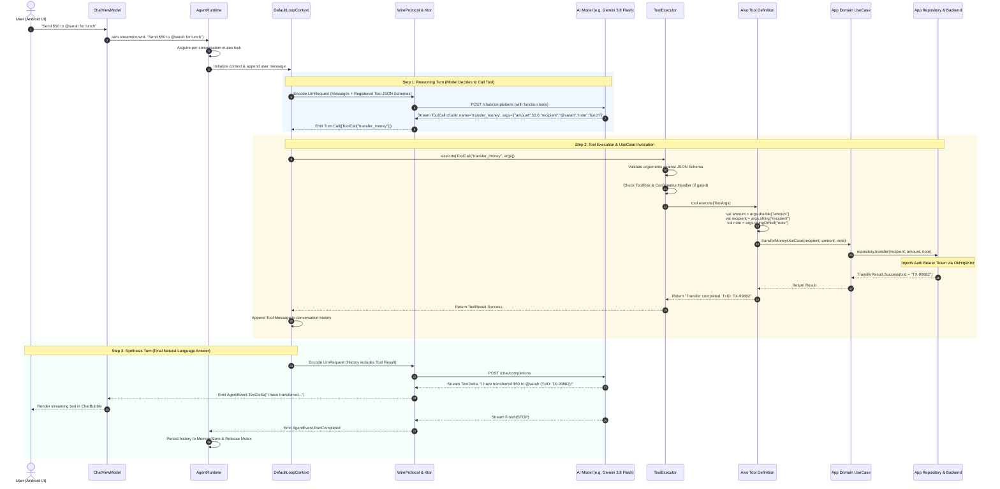

# End-to-End Tool Calling & UseCase Execution Flow

This document provides contributors and developers with a comprehensive, deep architectural walkthrough of how user messages flow through the **Aivo SDK**, how agents parse natural language into typed tool parameters, how tools bridge into Clean Architecture **UseCases**, and how results are synthesized into final streaming responses.

---

## 🗺️ 1. Architecture: The "Brain-to-Domain" Bridge

The core architectural invariant of Aivo SDK is **strict separation between AI reasoning and business logic**:
- **The LLM is the reasoning brain:** It decides *when* an action is needed and *what* values are required.
- **Your UseCases are the hands and feet:** They execute business logic, manage authentication tokens, and query network/databases.
- **The LLM never touches private tokens:** Backend JWTs and bearer tokens stay securely in your app's Repository/Network layer.

```mermaid
graph TD
    subgraph Presentation["1. Presentation Layer (Android)"]
        UI["Compose ChatScreen / MessageBubble"]
        VM["ChatViewModel (viewModelScope)"]
    end

    subgraph SDKRuntime["2. Aivo SDK Runtime"]
        RUNTIME["AgentRuntime (Conversation Mutex)"]
        CTX["DefaultLoopContext (think / act)"]
        LOOP["ToolCallingLoop (ReAct Cycle)"]
        TOOL_EXEC["ToolExecutor (Policy / Validation / Timeout)"]
    end

    subgraph AIProvider["3. LLM Provider (Cloud / Local)"]
        LLM["Google Gemini / OpenAI / Ollama"]
    end

    subgraph DomainLayer["4. App Domain Layer (Clean Architecture)"]
        TOOL["Aivo Tool Definition (tool DSL)"]
        USECASE["Domain UseCase (e.g., TransferMoneyUseCase)"]
    end

    subgraph DataLayer["5. Data & Network Layer"]
        REPO["Repository (Orders / Banking / User)"]
        SECURE["TokenManager / AuthInterceptor (Bearer Token)"]
        BACKEND["Remote Backend API / Room DB"]
    end

    UI -->|User prompt| VM
    VM -->|aivo.stream(prompt)| RUNTIME
    RUNTIME --> CTX
    CTX --> LOOP
    LOOP -->|Prompt + Tool JSON Schemas| LLM
    LLM -->|ToolCall('transfer', args)| LOOP
    LOOP -->|ToolCall| TOOL_EXEC
    TOOL_EXEC -->|ToolArgs| TOOL
    TOOL -->|invoke(params)| USECASE
    USECASE --> REPO
    REPO -.->|Reads Token| SECURE
    REPO -->|Authorized HTTP| BACKEND
    BACKEND -->|Result / Data| REPO
    REPO -->|Result| USECASE
    USECASE -->|Result / Error| TOOL
    TOOL -->|ToolResult.Success| TOOL_EXEC
    TOOL_EXEC -->|Role.TOOL Message| CTX
    CTX -->|History with Tool Result| LLM
    LLM -->|Streaming TextDelta| VM
    VM -->|StateFlow| UI
```

---

## 🔄 2. Complete End-to-End Lifecycle Sequence

Here is the exhaustive sequence of every event and transformation during a tool-calling conversation run:



---

## 🧠 3. How the Agent Understands Intent & Extracts Parameters

Developers often ask: **How does an AI model read natural language and know which word goes into which parameter?**

### Phase A: Tool Declaration Compiles to JSON Schema
When you define a tool in Kotlin, the SDK translates your DSL into a standard **JSON Schema (Draft-07)**:

```kotlin
// In your Kotlin code:
val transferTool = tool("transfer_money", "Transfers money from the user account to a recipient") {
    param("recipient", "Target username or account number", ParamType.String, required = true)
    param("amount", "Monetary amount in USD", ParamType.Double, required = true)
    param("note", "Optional payment note or purpose", ParamType.String, required = false)
}
```

The SDK's [`JsonSchema.kt`](file:///d:/Projects/AivoSdk/sdk-runtime/src/commonMain/kotlin/com/aivo/sdk/runtime/tool/schema/JsonSchema.kt) compiles this into:

```json
{
  "name": "transfer_money",
  "description": "Transfers money from the user account to a recipient",
  "parameters": {
    "type": "object",
    "properties": {
      "recipient": {
        "type": "string",
        "description": "Target username or account number"
      },
      "amount": {
        "type": "number",
        "description": "Monetary amount in USD"
      },
      "note": {
        "type": "string",
        "description": "Optional payment note or purpose"
      }
    },
    "required": ["recipient", "amount"]
  }
}
```

### Phase B: Semantic Entity Extraction & Grammar Analysis
When the user submits:
> *"Hey, could you transfer **fifty dollars** to **@sarah** for **lunch**?"*

The LLM does **not** use regex or keyword matching. Instead, its transformer attention heads perform **three cognitive operations**:

| Phrase in User Message | LLM Cognitive Deduction | Matched Schema Property | Converted Value |
| :--- | :--- | :--- | :--- |
| `"fifty dollars"` | Identifies number entity + currency USD. Matches `amount` description `"Monetary amount in USD"`. | `amount` (`Double`) | `50.0` (Normalized from text to float) |
| `"to @sarah"` | Preposition `"to"` denotes destination/receiver. Matches `recipient` description `"Target username"`. | `recipient` (`String`) | `"@sarah"` |
| `"for lunch"` | Preposition `"for"` indicates memo/purpose. Matches `note` description `"Optional payment note or purpose"`. | `note` (`String`) | `"lunch"` |

> [!TIP]
> **Type Coercion:** Notice that even if the user says *"fifty"*, the model's schema adherence translates the English word into a floating-point number (`50.0`) because the schema specified `"type": "number"`.

### Phase C: Handling Missing or Ambiguous Parameters
What happens if the user only says:
> *"Please transfer $50."*

1. The LLM compares the extracted parameters against the schema's `"required": ["recipient", "amount"]`.
2. It detects that `recipient` is **missing**.
3. **Instead of making up a fake value or failing**, the model automatically generates a conversational clarification:
   > *"Who would you like to transfer the $50 to?"*
4. When the user responds *"To @sarah"*, the SDK's [`MemoryStore`](file:///d:/Projects/AivoSdk/sdk-core/src/commonMain/kotlin/com/aivo/sdk/core/port/Ports.kt#L114) feeds the entire conversation history back to the model. The model combines `$50` from message 1 with `@sarah` from message 2, and then triggers the tool call.

---

## 💻 4. Parameter Extraction in Kotlin (`ToolArgs`)

When the model emits a tool call, the SDK receives the raw JSON and wraps it in a typed [`ToolArgs`](file:///d:/Projects/AivoSdk/sdk-runtime/src/commonMain/kotlin/com/aivo/sdk/runtime/tool/ToolBuilder.kt#L106) helper inside your `execute` suspend block:

```kotlin
execute { args ->
    // 1. Mandatory String (throws IllegalArgumentException if absent)
    val recipient: String = args.string("recipient")

    // 2. Mandatory Double
    val amount: Double = args.doubleOrNull("amount") 
        ?: throw IllegalArgumentException("Missing or invalid amount")

    // 3. Optional String
    val note: String? = args.stringOrNull("note")

    // 4. Raw JSON Object (for complex nested payloads or lists)
    val rawJson = args.arguments

    // Execute business logic with the clean typed values
}
```

### Type-Safe Extraction Methods
| Method | Return Type | Missing Parameter Behavior |
| :--- | :--- | :--- |
| `args.string(name)` | `String` | Throws `IllegalArgumentException` |
| `args.stringOrNull(name)` | `String?` | Returns `null` |
| `args.int(name)` | `Int` | Throws `IllegalArgumentException` |
| `args.intOrNull(name)` | `Int?` | Returns `null` |
| `args.doubleOrNull(name)` | `Double?` | Returns `null` |
| `args.bool(name)` | `Boolean` | Throws `IllegalArgumentException` |
| `args.boolOrNull(name)` | `Boolean?` | Returns `null` |
| `args.arguments` | `JsonObject` | Access full `kotlinx.serialization` JSON |

---

## 🏛️ 5. Clean Architecture Integration: UseCases as Tools

In Android development, modern production applications follow **Hexagonal / Clean Architecture**:
- **Presentation:** Jetpack Compose, ViewModel.
- **Domain:** Pure Kotlin UseCases, Models.
- **Data:** Repositories, Room Database, Retrofit / Ktor network clients.

Aivo SDK tools act as the **adapter** between the AI Runtime and your Domain UseCases.

### How Authentication Tokens are Managed

```
┌──────────────────────────────────────────────────────────────┐
│  AI Engine (Gemini / OpenAI / Ollama)                        │
│  - Knows: "Transfer $50 to @sarah"                           │
│  - DOES NOT KNOW: User Auth Tokens, Refresh Tokens, Cookies  │
└──────────────────────────────┬───────────────────────────────┘
                               │
                               ▼
┌──────────────────────────────────────────────────────────────┐
│  Aivo Tool (Android Device Runtime)                          │
│  - Extracts: recipient="@sarah", amount=50.0                 │
│  - Executes: transferMoneyUseCase(recipient, amount)         │
└──────────────────────────────┬───────────────────────────────┘
                               │
                               ▼
┌──────────────────────────────────────────────────────────────┐
│  Domain UseCase -> BankingRepository                         │
│  - Injects User Bearer Token from TokenManager               │
│  - Calls: POST /api/v1/transfers with Authorization header   │
└──────────────────────────────────────────────────────────────┘
```

> [!IMPORTANT]
> **Never send user authorization tokens to the LLM.**
> The LLM runs on external servers (Google, OpenAI, OpenRouter). By keeping your UseCases local, the LLM only tells your app *what action to take*. Your app executes the action locally using its existing secure credentials.

---

## 🚀 6. Full Real-World Example: Banking Assistant

Here is a complete, production-ready implementation showing every piece working together.

### Step 1: The Domain UseCase (Clean Architecture)
```kotlin
package com.example.banking.domain.usecase

import com.example.banking.domain.model.TransferReceipt
import com.example.banking.domain.repository.BankingRepository
import javax.inject.Inject

class TransferMoneyUseCase @Inject constructor(
    private val bankingRepository: BankingRepository
) {
    suspend operator fun invoke(
        recipientAccount: String,
        amount: Double,
        memo: String?
    ): Result<TransferReceipt> {
        if (amount <= 0) {
            return Result.failure(IllegalArgumentException("Amount must be greater than zero."))
        }
        return bankingRepository.executeTransfer(
            recipient = recipientAccount,
            amount = amount,
            memo = memo ?: "Transfer via AI Assistant"
        )
    }
}
```

### Step 2: The Aivo Tool Wrapping the UseCase
```kotlin
package com.example.banking.ai.tools

import com.aivo.sdk.core.model.ParamType
import com.aivo.sdk.core.model.ToolRisk
import com.aivo.sdk.tool
import com.example.banking.domain.usecase.TransferMoneyUseCase
import javax.inject.Inject

class BankingTools @Inject constructor(
    private val transferMoneyUseCase: TransferMoneyUseCase
) {
    val transferMoneyTool = tool(
        name = "transfer_money",
        description = "Transfers funds from the logged-in user's account to a recipient account or username"
    ) {
        risk(ToolRisk.HIGH)
        requiresConfirmation(true) // Triggers approval dialog before execution

        param(
            name = "recipient_account",
            description = "The recipient's account identifier, IBAN, or username (e.g. '@sarah' or 'ACC-4029')",
            type = ParamType.String,
            required = true
        )
        param(
            name = "amount",
            description = "The amount of money to transfer (in USD)",
            type = ParamType.Double,
            required = true
        )
        param(
            name = "memo",
            description = "Optional payment note or reason for transfer",
            type = ParamType.String,
            required = false
        )

        execute { args ->
            val recipient = args.string("recipient_account")
            val amount = args.doubleOrNull("amount")
                ?: throw IllegalArgumentException("Amount must be a valid number.")
            val memo = args.stringOrNull("memo")

            // Execute the suspended Clean Architecture UseCase
            val result = transferMoneyUseCase(
                recipientAccount = recipient,
                amount = amount,
                memo = memo
            )

            // Format the result for the LLM to read and summarize
            result.fold(
                onSuccess = { receipt ->
                    """
                    {
                      "status": "SUCCESS",
                      "transaction_id": "${receipt.transactionId}",
                      "amount_sent": ${receipt.amount},
                      "fee": ${receipt.fee},
                      "remaining_balance": ${receipt.newBalance}
                    }
                    """.trimIndent()
                },
                onFailure = { error ->
                    """
                    {
                      "status": "FAILED",
                      "error": "${error.message ?: "Transaction declined by bank."}"
                    }
                    """.trimIndent()
                }
            )
        }
    }
}
```

### Step 3: Registering the Tool with the Agent
```kotlin
package com.example.banking.ai

import com.aivo.sdk.AivoSdk
import com.aivo.sdk.provider.gemini.GeminiModel
import com.example.banking.BuildConfig
import com.example.banking.ai.tools.BankingTools
import javax.inject.Inject
import javax.inject.Singleton

@Singleton
class AgentClientFactory @Inject constructor(
    private val bankingTools: BankingTools
) {
    fun create(): AivoSdk {
        return AivoSdk {
            providers {
                gemini("gemini-primary") {
                    apiKey(BuildConfig.GEMINI_API_KEY)
                }
            }
            defaultModel(GeminiModel.GEMINI_3_8_FLASH)

            // Register all available tools
            tools {
                +bankingTools.transferMoneyTool
            }

            // Define specialized agents
            agents {
                define("banking_specialist") {
                    name = "Banking Specialist"
                    systemPrompt = """
                        You are a secure, helpful banking assistant.
                        You help users review transactions and transfer funds.
                        Always confirm recipient details before taking action.
                    """.trimIndent()

                    // Assign the tool specifically to this agent
                    tools("transfer_money")
                }
            }
            entryAgent("banking_specialist")
        }
    }
}
```

### Step 4: Calling from ViewModel and Streaming Events to Compose
```kotlin
package com.example.banking.ui.chat

import androidx.lifecycle.ViewModel
import androidx.lifecycle.viewModelScope
import com.aivo.sdk.core.model.AgentEvent
import com.aivo.sdk.core.model.ConversationId
import com.example.banking.ai.AgentClientFactory
import dagger.hilt.android.lifecycle.HiltViewModel
import kotlinx.coroutines.flow.MutableStateFlow
import kotlinx.coroutines.flow.asStateFlow
import kotlinx.coroutines.flow.update
import kotlinx.coroutines.launch
import javax.inject.Inject

@HiltViewModel
class ChatViewModel @Inject constructor(
    agentFactory: AgentClientFactory
) : ViewModel() {

    private val aivo = agentFactory.create()
    private val conversationId = ConversationId("user_session_main")

    private val _uiState = MutableStateFlow(ChatUiState())
    val uiState = _uiState.asStateFlow()

    fun sendMessage(userText: String) {
        viewModelScope.launch {
            _uiState.update { it.copy(isGenerating = true) }

            aivo.stream(conversationId, userText).collect { event ->
                when (event) {
                    is AgentEvent.ToolCallStarted -> {
                        // Show "Calling transfer_money..." spinner in UI
                        _uiState.update { it.copy(activeTool = "Processing ${event.toolName}...") }
                    }
                    is AgentEvent.ToolCallExecuted -> {
                        // Dismiss tool execution indicator
                        _uiState.update { it.copy(activeTool = null) }
                    }
                    is AgentEvent.TextDelta -> {
                        // Stream final answer token-by-token directly to Compose UI
                        _uiState.update { it.appendStreamingText(event.text) }
                    }
                    is AgentEvent.RunCompleted -> {
                        _uiState.update { it.copy(isGenerating = false) }
                    }
                    is AgentEvent.RunFailed -> {
                        _uiState.update { it.copy(isGenerating = false, error = event.error.message) }
                    }
                    else -> Unit
                }
            }
        }
    }
}
```

---

## 🔬 7. What Goes Over the Wire (The Exact JSON Payloads)

To help contributors understand what passes over the wire between the SDK and LLM providers during this flow:

### 1. Request to LLM (Turn 1: User Request)
```json
{
  "model": "gemini-3.8-flash",
  "messages": [
    { "role": "system", "content": "You are a secure, helpful banking assistant." },
    { "role": "user", "content": "Send $50 to @sarah for lunch" }
  ],
  "tools": [
    {
      "type": "function",
      "function": {
        "name": "transfer_money",
        "description": "Transfers funds from the logged-in user's account to a recipient account or username",
        "parameters": {
          "type": "object",
          "properties": {
            "recipient_account": { "type": "string", "description": "The recipient's account identifier..." },
            "amount": { "type": "number", "description": "The amount of money to transfer..." },
            "memo": { "type": "string", "description": "Optional payment note..." }
          },
          "required": ["recipient_account", "amount"]
        }
      }
    }
  ]
}
```

### 2. LLM Response to SDK (Turn 1: Tool Call Emitted)
```json
{
  "choices": [
    {
      "message": {
        "role": "assistant",
        "content": null,
        "tool_calls": [
          {
            "id": "call_tx_12345",
            "type": "function",
            "function": {
              "name": "transfer_money",
              "arguments": "{\"recipient_account\": \"@sarah\", \"amount\": 50.0, \"memo\": \"lunch\"}"
            }
          }
        ]
      }
    }
  ]
}
```

### 3. Request to LLM (Turn 2: Synthesis with Tool Result)
```json
{
  "model": "gemini-3.8-flash",
  "messages": [
    { "role": "system", "content": "You are a secure, helpful banking assistant." },
    { "role": "user", "content": "Send $50 to @sarah for lunch" },
    {
      "role": "assistant",
      "tool_calls": [{ "id": "call_tx_12345", "type": "function", "function": { "name": "transfer_money" } }]
    },
    {
      "role": "tool",
      "tool_call_id": "call_tx_12345",
      "content": "{\"status\": \"SUCCESS\", \"transaction_id\": \"TX-99882\", \"amount_sent\": 50.0, \"fee\": 0.0, \"remaining_balance\": 450.0}"
    }
  ]
}
```

### 4. Final Streamed LLM Response (Turn 2: Synthesis)
```text
I have successfully transferred $50.00 to @sarah for lunch!
Transaction ID: TX-99882. Your new balance is $450.00.
```

---

## 🛡️ 8. Contributor Invariants for Tool Calling

When working on or modifying [`ToolCallingLoop.kt`](file:///d:/Projects/AivoSdk/sdk-runtime/src/commonMain/kotlin/com/aivo/sdk/runtime/agent/ToolCallingLoop.kt), [`ToolExecutor.kt`](file:///d:/Projects/AivoSdk/sdk-runtime/src/commonMain/kotlin/com/aivo/sdk/runtime/tool/ToolExecutor.kt), or [`DefaultLoopContext.kt`](file:///d:/Projects/AivoSdk/sdk-runtime/src/commonMain/kotlin/com/aivo/sdk/runtime/agent/DefaultLoopContext.kt):

1. **Tool Exceptions Must Never Crash the App:**
   All exceptions thrown inside `execute` blocks are caught by `ToolBuilder` and converted to `ToolResult.Failure`. The failure string is passed back to the LLM so the model can gracefully explain the issue to the user.
2. **Never Catch `CancellationException`:**
   If the user navigates away or cancels the coroutine, `CancellationException` must propagate immediately to halt network calls and coroutine execution.
3. **Atomic History Commit:**
   Tool call requests and their corresponding tool results must be appended to [`MemoryStore`](file:///d:/Projects/AivoSdk/sdk-core/src/commonMain/kotlin/com/aivo/sdk/core/port/Ports.kt#L114) together. Never persist a tool call without its corresponding result.
4. **Infinite Loop Protection:**
   [`ToolCallingLoop`](file:///d:/Projects/AivoSdk/sdk-runtime/src/commonMain/kotlin/com/aivo/sdk/runtime/agent/ToolCallingLoop.kt) monitors consecutive identical tool calls. If an agent calls the exact same tool with the exact same arguments 3 times, the loop forces synthesis with `ToolSelection.None` to break potential cycles.
